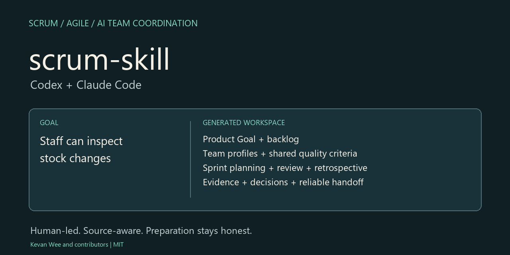
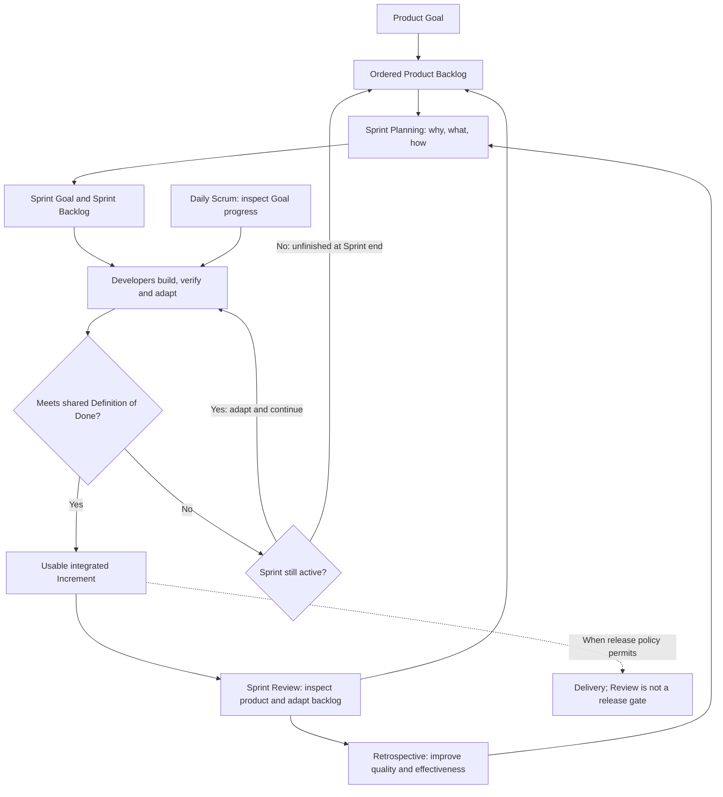
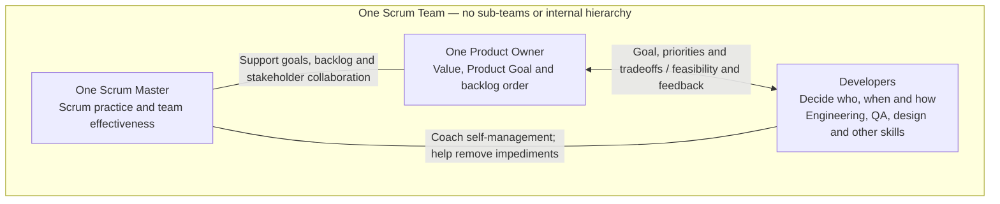
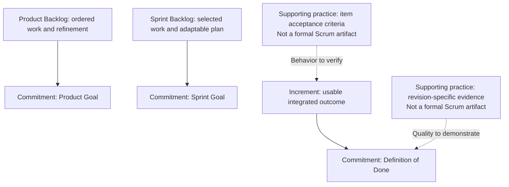
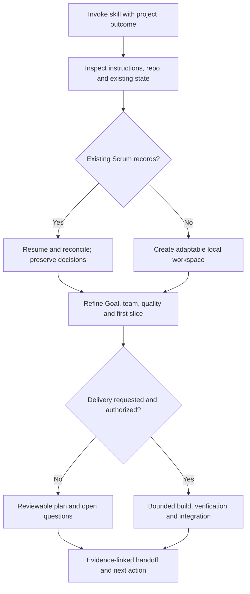
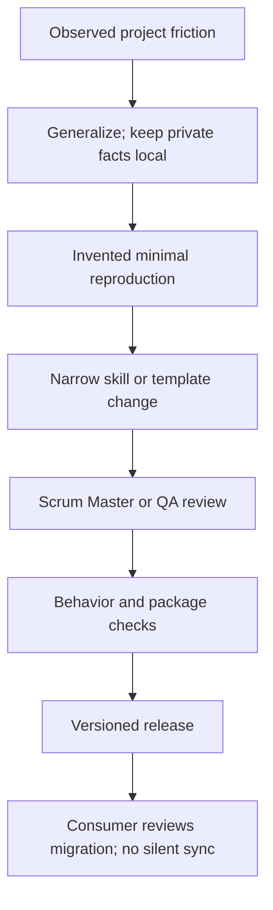

# scrum-skill - Scrum coordination for Codex and Claude Code

[](https://github.com/kevanwee/scrum-skill/actions/workflows/ci.yml)
[](LICENSE)
[](https://github.com/kevanwee/scrum-skill/tags)


> An experiment in applying Scrum principles with AI teammates. A human remains accountable for product decisions.

A project-neutral skill for **Codex and Claude Code**. Invoke it to create or resume a Scrum workspace, refine a backlog, plan and deliver a bounded slice, inspect outcomes, improve the process and leave a reliable handoff.

The human Product Owner can work in any domain. Engineering, QA, design, security and domain reviewers are selected for the project. Legal counsel, specific models, frontend packages and vendor plugins are **optional**, not built-in requirements.

Version **0.5.0** · MIT · Two skills: [`scrum-skill`](skills/scrum-skill/SKILL.md) and [`scrum-dashboard`](skills/scrum-dashboard/SKILL.md). No bundled MCP server, lifecycle hook, telemetry or automatic cross-project synchronization. The optional workspace helper uses Python 3.10+ and the standard library.

## See what it creates



[Run the inventory example](examples/inventory/README.md) to see real scaffold output.
The image summarizes that helper output; it is not a native-host execution screenshot.

## Start here

Choose **one** installation route to avoid duplicate skill names.

### Codex plugin

```sh
codex plugin marketplace add kevanwee/scrum-skill --ref v0.5.0
codex plugin add scrum-skill@scrum-skills
```

Reload/start a session if needed, then invoke:

```text
$scrum-skill Set up Scrum for this project. I am the Product Owner.
Our goal is a small inventory app. Use engineering, QA and design agents
where available. Create the artifacts and propose the first usable slice.
```

The repo catalog is a distribution source, not an official OpenAI directory listing. Host/plugin availability varies by surface. See [official package/catalog guidance](https://developers.openai.com/plugins/build/plugins).

### Claude Code plugin

```sh
claude plugin marketplace add kevanwee/scrum-skill
claude plugin install scrum-skill@scrum-skills
```

Reload/start a session if needed. Plugin skills use a namespace:

```text
/scrum-skill:scrum-skill Set up Scrum for this project and propose a first Sprint.
```

For local development after cloning, `claude --plugin-dir /path/to/scrum-skill` loads the plugin for that session. See [Claude plugin guidance](https://code.claude.com/docs/en/plugins) for supported surfaces, scopes and trust settings.

### Direct skill folder

Install just `skills/scrum-skill/` if you do not need a plugin catalog. For Codex, ask `$skill-installer` to install that path from this repository at `v0.5.0`, or copy it into your project's `.agents/skills/scrum-skill/`. For Claude Code, copy it into `.claude/skills/scrum-skill/` and invoke `/scrum-skill`. Preserve its scripts, references and assets. Do not overwrite an existing installation without reviewing the change.

Skills-only installation does not register a plugin, hooks or an agent runtime. See [Codex skill discovery](https://learn.chatgpt.com/docs/build-skills). This repo publishes compatible metadata; it does not install anything into your account automatically.

## What you can ask

Use explicit modes or a role-specific request; a bare call opens a guided wizard.

```text
$scrum-skill wizard
$scrum-skill setup --goal "Staff can inspect stock changes" --roles engineering,qa,design
$scrum-skill resume
$scrum-skill plan
$scrum-skill deliver --target US-7
$scrum-skill role design plan --target apps/web
$scrum-skill role legal-counsel review --target docs/architecture
$scrum-skill role qa review --target .github/workflows/ci.yml
```

[Invocation guide](skills/scrum-skill/references/invocation.md) explains modes, role aliases,
the guided wizard and the optional intent resolver. These argument routes use one
canonical skill; they do not register separate workers or automatically run tools.
Natural-language requests continue to work:

```text
$scrum-skill Resume from the project's latest handoff and reconcile the actual state.
$scrum-skill Refine these stories, identify evidence gaps and plan the next Sprint.
$scrum-skill Plan and start the next authorized slice; coordinate specialists and verify it.
$scrum-skill Prepare a Sprint Review using actual results and separate unfinished work.
$scrum-skill Run a retrospective and propose a few measurable improvements.
```

Use `/scrum-skill:scrum-skill` for the plugin version in Claude Code. Setup/planning creates artifacts; it does not by itself authorize implementation, pushes, deployment or messages. If your host cannot delegate, the coordinator works sequentially and records that mode.

## Project dashboard and estimation

The plugin includes an offline dashboard skill. Direct folder installations must also
copy `skills/scrum-dashboard/` into the host's skill directory to use it.

```text
$scrum-skill dashboard
$scrum-dashboard Generate a local dashboard from .scrum/metrics.json.
```

Claude plugin: `/scrum-skill:scrum-dashboard`. The dashboard shows **project burndown
by Sprint**, completed Sprint velocity, changing backlog scope, progress and a dated
Gantt timeline. It has no daily chart or separate burnup. Missing dates, estimates and
history remain visible; agent speed does not invent a two-week calendar.

[Dashboard schema and commands](skills/scrum-dashboard/references/schema.md) explain
how to supply snapshots. New workspaces start with an empty `metrics.json`; the helper
does not infer history from Markdown. Generate a labeled synthetic demo with:

```sh
python skills/scrum-dashboard/scripts/generate_dashboard.py --demo --output demo.html
```

[Preview the synthetic dashboard](assets/dashboard-demo.png).

Open the resulting HTML locally. It needs no server or external libraries and embeds
all input data, so sharing it shares that data.

Stories now have explicit point/estimate-state fields and an estimate decision ledger.
[Estimation and Planning Poker](skills/scrum-skill/references/estimation.md) cover actual
participants, private votes, discussion and agreement, provisional agent estimates,
capacity, unfinished work and frozen historical velocity. Points and Planning Poker
are supporting practices, not mandatory Scrum rules.

[Project lifecycle guide](skills/scrum-skill/references/project-lifecycle.md) connects
discovery, refinement, delivery, reviews, releases and operational handover.
[Workflow review](docs/WORKFLOW_REVIEW.md) records coverage and remaining limits.

## Scrum at a glance

Scrum uses transparency, inspection and adaptation to work toward a Product Goal. These diagrams summarize the framework; [source attribution and packaging references](SOURCES.md) distinguish Scrum rules from this package's AI/project conventions. Using only selected practices is **Scrum-informed**, not a claim of full Scrum implementation or certification.



One active Sprint, fixed length of one month or less. The team chooses a useful cadence; two weeks is a starting convention. The Developers own their plan and estimates. A timebox ending does not turn unfinished work into a Done Increment.

## Who does what?



The Product Owner is one person; the Scrum Master serves the whole team. Developers own their plan, estimates and implementation choices. Layout and connecting lines express collaboration, not reporting authority. AI workers assist these accountabilities; a generated profile is not a human appointment, stakeholder participation or regulated professional sign-off. This package deliberately keeps a human accountable for product decisions.

### Predefined behavior guides

Legal Counsel reviews platform/design choices, flags legal risk and advises on defensible options and safeguards. Privacy counsel focuses on applicable data-handling requirements. Their output guides product/design decisions; source-backed human judgment remains necessary.

Identify the Product Owner and Scrum Master from actual instructions or project records. Skill invocation does not appoint anyone. If either is unknown, record it as unresolved and call the current setup Scrum-informed. The optional helper accepts `--product-owner` and `--scrum-master` for identities already supplied; neither proves appointment, participation or full Scrum implementation.

Read [accountability guides](skills/scrum-skill/references/accountabilities.md) for Product Owner, Scrum Master and Developers behavior and decision boundaries. [Role selection](skills/scrum-skill/references/roles.md) links presets for engineering, QA, UI/UX, security, optional Legal Counsel and PDPA/GDPR Counsel, AI/data, operations and domain review. Each preset describes its contribution, working approach, evidence and boundaries. Specialisms share one Definition of Done and collaborate throughout delivery.

Setup copies selected presets into `.scrum/roles/`; unknown role names use the adaptable template. Existing profiles are preserved. These are portable instructions, not automatically registered agents. For example: `--specialists engineering,qa,design,security`; ask a delegated worker to read its profile, the shared DoD and its bounded task when delegation is authorized.

### External skills and libraries

On a clean run, the [first-run setup](skills/scrum-skill/references/first-run-imports.md) identifies the selected team's required imports, presents concrete commands and scope, and verifies availability after installation. Legal roles select LQ bundles; web design selects taste/minimalist/redesign, Impeccable and applicable GSAP/Lenis libraries. Full LQ catalog import is an explicit option. Required missing tools keep the affected workflow unready until imported or an explicit fallback is chosen.

scrum-skill contains original instructions, profiles and a workspace helper. It does not vendor LQ, taste-skill, Impeccable, GSAP or Lenis source, install those dependencies, or register specialist agents. The [routing protocol](skills/scrum-skill/references/dependency-routing.md) requires resolving actual host availability, loading the selected skill and recording what ran or was unavailable. Source links alone are not executable integration. GSAP and Lenis are application libraries, not agent skills.

## Artifacts and commitments




Acceptance criteria describe each item's behavior. The Definition of Done describes shared product quality. Acceptance criteria and evidence maps are supporting practices, not additional formal Scrum artifacts. CI, architecture, accessibility, security/privacy and domain review are chosen for the actual project. Local tests, mocks and coverage do not establish every integration or human decision.

## Events are different conversations

| Event | Inspect/adapt | Record actual participation or label preparation |
| --- | --- | --- |
| Sprint Planning | Why this Sprint matters, what is feasible, how to deliver | Goal, selected items, capacity/uncertainty and plan |
| Daily Scrum | Progress toward the Goal and the Developers' next plan | Evidence, plan changes and impediments |
| Sprint Review | Product outcome, real stakeholder feedback and backlog order | Done results; unfinished work listed separately |
| Retrospective | Collaboration, tools, quality and assumptions | Owned improvements with observable success measures |

Review is not merely a demo; retrospective is not product acceptance. Async agent notes help prepare events but do not prove a human ceremony occurred. Never fabricate attendance, velocity, passed tests or approval.

## What one invocation sets up



The optional helper creates these records, all initially **proposed/preparatory**:

```text
project/
  AGENTS.md                 Preserved; a small marked resume pointer is appended
  CLAUDE.md                 Preserved; the same pointer is appended
  .gitignore                Preserved; .scrum/ ignored by default
  .scrum/
    workspace.json          Skill version and project configuration
    TEAM.md, roles/         Adaptable specialist profiles
    ACCOUNTABILITIES.md     Product Owner, Scrum Master and Developers behavior
    PRODUCT_GOAL.md, PRODUCT_BACKLOG.md, DEFINITION_OF_DONE.md
    DECISIONS.md, IMPEDIMENTS.md, EVIDENCE.md
    sprints/                Forecast, planning, review and retrospective
    handoffs/INITIAL.md, handoffs/LATEST.md
    MASTER_PROMPT.md         Fresh-session resume instructions
```

For a manual setup preview from a clone:

```sh
python skills/scrum-skill/scripts/init_workspace.py --root /path/to/project --name inventory --goal "Staff can track stock changes" --specialists engineering,qa,design --dry-run
```

Run without `--dry-run` only when you intend setup. Use `--specialists none` for a sequential generalist. Existing records are not overwritten; malformed pointer blocks, conflicting project identity and path escapes fail before writes. Choose an explicit `--start-date YYYY-MM-DD` in the project's timezone when dates matter. The helper does not run tests, create a Git repo, push, spawn agents or deploy; the skill guides authorized work afterward.

## Improve it from real projects



Keep one canonical skill under `skills/scrum-skill`. Both host manifests and catalogs point to it; there are no generated copies to drift. A project's domain safeguard or tool choice becomes an optional profile, not a universal rule. See [maintenance guidance](skills/scrum-skill/references/maintenance.md) and [contributing](CONTRIBUTING.md).

## Validation and limits

```sh
python scripts/validate_package.py
python -m unittest discover -s tests -v
claude plugin validate .claude-plugin/plugin.json
claude plugin validate .claude-plugin/marketplace.json
```

Package tests check manifest paths/versions, references and helper behavior. They do not certify facilitation quality or claim a live installed session on every host. The [evaluation record](EVALUATION.md) describes what was actually exercised. Mermaid README sources are rendered during authoring to catch syntax/layout failures. No supplied PDFs or project-specific backlog content is part of this repo.

## Credits and contributions

Created by **Kevan Wee and contributors**, licensed under MIT. See [contributing](CONTRIBUTING.md) and [help-wanted issues](https://github.com/kevanwee/scrum-skill/issues?q=is%3Aissue%20is%3Aopen%20label%3A%22help%20wanted%22).
